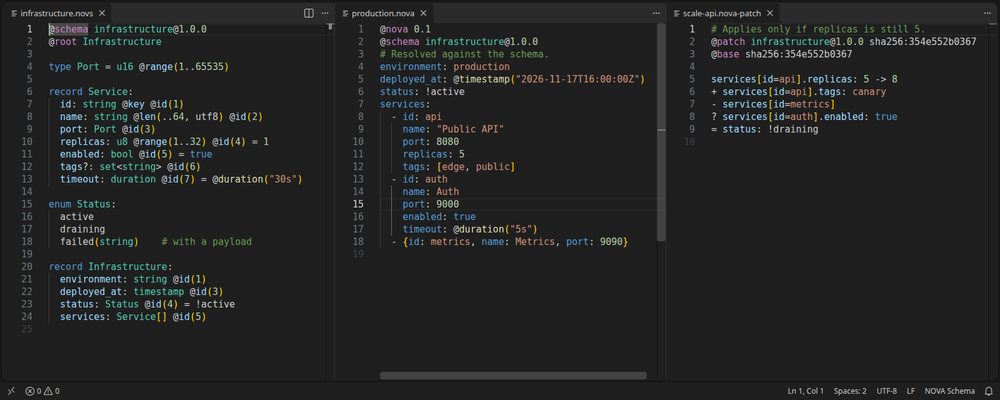

# NOVA for Visual Studio Code

Language support for [NOVA](https://novafile.dev/), the *Notation for Objects, Values & Agents*: a typed, indentation-exact serialization format with schemas, conditional patches and total templates.

The extension provides syntax highlighting for every kind of NOVA file and connects VS Code to the `nvf-lsp` language server from the [reference implementation](https://github.com/novafile/nova).



## Features

| | `.nova` documents and templates | `.novs` schemas | patches |
| --- | --- | --- | --- |
| Syntax highlighting | ✓ | ✓ | ✓ |
| Diagnostics (syntax, schema validation, lints) | ✓ | ✓ | ✓ |
| Hover | ✓ | ✓ | ✓ |
| Outline / document symbols | ✓ | ✓ | ✓ |
| Completion | ✓ | ✓ | ✓ |
| Formatting | ✓ | ✓ | ✓ |

Highlighting, comment toggling, bracket matching and indentation work without the language server. Diagnostics, hover, outline, completion and formatting come from `nvf-lsp`.

**Highlighting covers the whole text syntax ([spec §4](https://github.com/novafile/spec/blob/main/SPEC.md)):**

- directives (`@nova`, `@schema name@1.2.0#fingerprint`, `@revision`, `@scope`, `@mode positional`, `@compat`, `@get`, `x-` extensions);
- block records and lists, quoted keys, tables (`services[2]{id,port}:` and their rows);
- plain scalars, classified exactly like the parser: `8080` is an integer, `22/7` a rational, `1.5e3` a float, `true`/`false`/`null` keywords, while `1.2.3`, `08080` and `yes` stay strings;
- quoted strings with escapes (`\n`, `\u00e9`, `\u{1F600}`, `\$`) and invalid escapes;
- block strings (`|`, `|-`), which end at the first line that is not indented deeper;
- flow values `[…]`, `{…}`, `(…)`, `@set[…]`, `@map{k => v}`;
- typed literals `@timestamp(…)`, `@duration(…)`, `@decimal(…)`, `@rational(…)`, `@bytes(…)`, `@float(…)` and variants `!active`, `!failed("disk full")`;
- **templates** (§9): `@template`, `@param`, `@let`, `@import`, `$references.with[paths]`, `${interpolation}` (only inside template documents), `...spreads`, and `@if` / `@else if` / `@else` / `@for i, x in $xs:` control lines;
- **patches** (§7.4): `@patch`, `@base`, `@scope`, and the operations `path: old -> new`, `= p: v`, `+ p: v`, `- p`, `? p`;
- **schemas** (§6.1): `record Name @open:`, `enum Name:` / `enum Name = a | b(T)`, `type X = T`, field lines `name?: list<u16 @range(1..1024)>[]? @key @id(1) @len(..64, utf8) @deprecated = default`.

### Languages and files

| Language id | Files |
| --- | --- |
| `nova` | `*.nova` (data documents, templates such as `*.tpl.nova`, query responses, positional documents) |
| `nova-schema` | `*.novs` |
| `nova-patch` | `*.patch` files whose first non-comment line is `@patch`; also `*.nova-patch` |

`.patch` is normally owned by VS Code's built-in *Diff* language, so the extension does not claim it by extension. When a `.patch` file opens as Diff, the extension looks at its first non-blank, non-comment line and switches the editor to *NOVA Patch* if it is a `@patch` directive (turn this off with `novafile.patch.detectByContent`). To force it for a folder, add a file association:

```jsonc
"files.associations": { "overlays/*.patch": "nova-patch" }
```

## Installing

Install the extension from the [Visual Studio Marketplace](https://marketplace.visualstudio.com/items?itemName=novafile.vscode-novafile), or run this in VS Code's Quick Open (<kbd>Ctrl</kbd>+<kbd>P</kbd>):

```text
ext install novafile.vscode-novafile
```

Each [GitHub Release](https://github.com/novafile/vscode-novafile/releases) also carries the `.vsix` with a build provenance attestation; check a download with `gh attestation verify vscode-novafile-X.Y.Z.vsix -R novafile/vscode-novafile`.

## Language server

The extension ships a WebAssembly build of the `nvf-lsp` language server, so diagnostics, hover, completion and formatting work out of the box, including in VS Code for the Web (vscode.dev, github.dev). It runs through Microsoft's [WASI execution engine](https://marketplace.visualstudio.com/items?itemName=ms-vscode.wasm-wasi-core), which VS Code installs alongside this extension.

A native `nvf-lsp` is faster and is used instead whenever one is available: either `novafile.server.path` is set in your user settings, or `nvf-lsp` is on your `PATH`. Install it with Cargo:

```sh
cargo install novafile-lsp                  # from crates.io
# or, from a checkout of https://github.com/novafile/nova
cargo install --path crates/novafile-lsp
```

Run **NOVA: Restart Language Server** after installing or updating it. **NOVA: Show Language Server Output** shows which server was started.

The server reads every `.novs` file in the workspace, so a document's `@schema infrastructure@1.0.0` line is validated against the matching schema automatically.

## Settings

| Setting | Default | Description |
| --- | --- | --- |
| `novafile.server.path` | `""` | Path to a native language server: absolute, `~/…`, or a bare name looked up on `PATH`. Empty means `nvf-lsp` on `PATH`, else the bundled WebAssembly build. |
| `novafile.server.args` | `[]` | Extra arguments for the server. |

`novafile.server.path` and `novafile.server.args` are read from user (or remote machine) settings only. Workspace settings cannot change them, so opening a repository never makes the extension run a program that the repository chose.
| `novafile.server.enable` | `true` | Set to `false` to use highlighting only. |
| `novafile.trace.server` | `"off"` | `messages` or `verbose` logs LSP traffic to the *NOVA Language Server Trace* output channel. |
| `novafile.patch.detectByContent` | `true` | Switch `.patch` files that start with `@patch` to NOVA Patch. |

The extension also sets `editor.tabSize: 2` and `editor.insertSpaces: true` for its languages, because NOVA indentation is exactly two spaces per level.

## Commands

- **NOVA: Restart Language Server** (`novafile.restartServer`)
- **NOVA: Show Language Server Output** (`novafile.showOutput`)

## Development

```sh
yarn install
yarn compile    # type-check and bundle to dist/ with esbuild
yarn test       # grammar tests (vscode-tmgrammar-test)
yarn package    # build vscode-novafile-<version>.vsix with @vscode/vsce
```

Press <kbd>F5</kbd> in VS Code to start an Extension Development Host.

The TextMate grammars in `syntaxes/` are generated from `scripts/build-grammars.mjs`, which keeps the regular expressions readable. Edit that file, then run `yarn build:grammars` and commit both. Grammar tests live in `test/`. Each file starts with a `# SYNTAX TEST "<scope>"` header, and lines with `^` or `<-` markers assert the scopes of the source line above them.

### Releasing

1. Bump `version` in `package.json` and date the changelog section, in a PR.
2. After it is merged, tag the merge commit on `main`: `git tag -s vX.Y.Z -m "vscode-novafile X.Y.Z"`, then push the tag. CI checks that the tag matches `package.json`, packages and attests the `.vsix`, and creates the GitHub Release.
3. The release job then starts `.github/workflows/publish.yml`, which waits for approval in the `marketplace` environment. Once approved, it downloads the release's `.vsix`, verifies its attestation and version, and publishes it to the Marketplace with trusted publishing (`vsce publish --oidc`). No token is stored.

To publish an existing release, run `gh workflow run publish.yml -f tag=vX.Y.Z`. A version that is already on the Marketplace is skipped.

## Links

- Website: <https://novafile.dev/>
- Specification: <https://github.com/novafile/spec> ([SPEC.md](https://github.com/novafile/spec/blob/main/SPEC.md))
- Reference implementation, CLI `nvf` and language server `nvf-lsp`: <https://github.com/novafile/nova>
- Issues: <https://github.com/novafile/vscode-novafile/issues>

## License

The extension code is licensed under either the [EUPL-1.2](LICENSE-EUPL) or the [MPL-2.0](LICENSE-MPL), at your option. The grammar definitions (`syntaxes/` and `scripts/build-grammars.mjs`) are part of the format definition and licensed under [Apache-2.0](LICENSE-APACHE), like the [specification](https://github.com/novafile/spec); the grammar test files are CC0-1.0. See [REUSE.toml](REUSE.toml).
